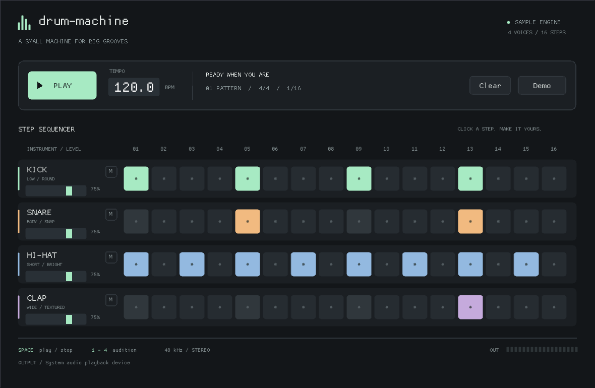

# drum-machine

A small, standalone drum machine for Linux. Four sample instruments, one editable
16-step pattern, and a C++ engine designed to carry over to an embedded Linux instrument.



## Build and run

Requires a C++20 compiler, CMake 3.24+, Ninja (or another CMake generator), Git,
and Linux audio/window development libraries. For Ubuntu/Debian:

```sh
sudo apt install build-essential cmake ninja-build git pkg-config \
    libasound2-dev libpulse-dev libx11-dev libxext-dev libxrandr-dev \
    libxcursor-dev libxi-dev libxfixes-dev libxss-dev libwayland-dev \
    libxkbcommon-dev libegl1-mesa-dev libgl1-mesa-dev
cmake -S . -B build -G Ninja -DCMAKE_BUILD_TYPE=Release
cmake --build build
./build/drum-machine
```

The first configure downloads SDL **3.2.28** (unless a compatible SDL3 CMake package
is installed) and Dear ImGui **1.92.4**. Dependencies are fetched into the build
directory; subsequent builds work offline. Local source checkouts in `.deps/SDL`
and `.deps/imgui` are also supported. The samples are already included, and are
copied alongside the executable during the build.

## Play

- Click **Play**, or press **Space**, to start and stop. Playback starts at step 1;
  stopping lets existing drum hits decay.
- Click grid cells to toggle hits. Groups of four steps mark the four beats of a bar.
- Drag the tempo value, or Ctrl+click it to type a value, between 40 and 240 BPM.
- Adjust the level below each instrument; **M** mutes and restores its level.
- Click an instrument name, or press **1–4**, to audition it, even while stopped.
- **Clear** removes every step; **Demo** restores the starter groove.

Patterns and settings currently live in memory and reset when the application exits.
The initial scope excludes MIDI, effects, sample browsing, and pattern storage.

## Verify

```sh
ctest --test-dir build --output-on-failure
./build/drum-machine --render-demo /tmp/drum-machine-demo.wav
./build/drum-machine --smoke-test
```

The engine tests check sample-accurate timing over multiple loops with irregular
audio buffers, pattern bit mapping, transport restart, tempo changes, stereo mixing,
and sample previews. The desktop smoke test clicks a step, clicks Play, and presses
Space to stop using injected SDL events. It uses SDL's dummy video/audio drivers
and software renderer, so it works without a display or sound device. The render
test exercises WAV decoding/conversion and exports two bars of the default groove.

The dependency-free engine can be built and tested without downloading SDL or ImGui:

```sh
cmake -S . -B build-core -G Ninja -DDRUM_MACHINE_BUILD_APP=OFF
cmake --build build-core
ctest --test-dir build-core --output-on-failure
```

For a screenshot, `--screenshot /tmp/drum-machine.bmp` captures the second frame; combine it
with `--smoke-test` for a headless capture. `--assets DIR` overrides the asset root.

## Architecture and embedded port

`src/engine.*` contains the sequencer and sampler, with no SDL or UI dependency.
`Controls` is the boundary: the interface writes atomic pattern masks, levels,
tempo, transport state, and preview requests. The engine alone owns voice positions
and the musical clock, and publishes the current step and output peak.

The audio callback requests stereo float PCM at 48 kHz. Step timing follows rendered
sample frames, with fractional phase retained across buffers and tempo changes.
The engine preloads samples, smooths gain changes, and applies soft saturation at the
output. Its render path performs no allocations, file operations, or blocking locks
on the supported x86-64/AArch64 targets. The SDL adapter uses a fixed-size scratch
buffer and feeds SDL's audio stream. SDL handles device format conversion.

The desktop UI uses Dear ImGui and SDL's 2D renderer, without a custom graphics
engine. To port to an ARM64 Linux SBC:

1. Build with a CMake toolchain file for the board, or build natively on the board.
2. Verify the board's display and audio drivers with SDL before designing the enclosure.
3. Feed physical button/encoder events into the same `Controls` boundary. Keep GPIO,
   I2C, display updates, and file I/O outside the audio callback.
4. Retain this UI for a suitable display, or replace it with a hardware-specific frontend.

SDL backend availability depends on the target build and drivers; a board port has
not yet been verified. The default SDL audio-device selection is used. A 256-frame
device buffer is requested as a hint; actual latency depends on the backend/device.

Installation is optional:

```sh
cmake --install build --prefix "$HOME/.local"
```

Fetched SDL is linked statically. If you use an installed SDL3 package instead,
ensure its runtime library is also available on the destination.

## Samples and licenses

The four bundled WAV one-shots are original synthesized sounds. Reproduce them with
`python3 tools/generate_samples.py` (Python standard library only, deterministic seed).
There are no external sample-pack dependencies.

Project code and bundled samples use the BSD 3-Clause license; see [LICENSE](LICENSE).
SDL uses the zlib license; Dear ImGui uses the MIT license. Their fetched source
trees retain the upstream notices. See [THIRD_PARTY.md](THIRD_PARTY.md).
