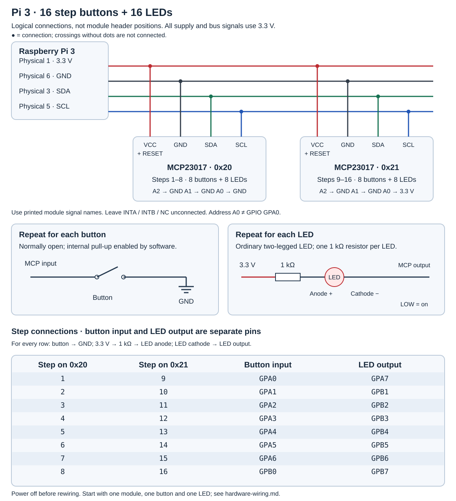

# Pi 3, step buttons and LEDs: wiring reference

This is the wiring supported by the current code: **two MCP23017 / CJMCU-2317
modules, 16 step buttons and 16 step LEDs**. Each module handles eight buttons
and eight LEDs. The engine has four tracks; select the track and operate the
other controls through the SSH terminal.

The [eight-track plan](hardware-wiring-8-tracks.md) is future work. It does not
change these connections. No ADC or separate LED driver is needed for this setup.

## Wiring schema



[Open the full-size diagram](images/step-wiring.svg). This is a logical wiring
schema, **not the physical layout of the module headers**. Follow printed signal
names on your modules. Dots in the diagram mark connected wires; crossings
without dots are not connections. The table below assigns every button and LED.

## 1. Pi to both modules

Shut down and disconnect power before changing wiring. Power both modules at
**3.3 V**, with common ground. Do not use the Pi's 5 V header pins for these
modules or LED branches. These are **physical Pi header positions**:

| Pi physical pin | Function | Connect to both modules |
| ---: | --- | --- |
| 1 | 3.3 V | VCC / VDD and RESET / RST |
| 6 | GND | GND / VSS |
| 3 | BCM GPIO2 / SDA1 | SDA |
| 5 | BCM GPIO3 / SCL1 | SCL |

Leave INTA, INTB and NC unconnected. Keep bus wiring short. The Pi already has
I²C pull-ups; do not add more by default. Check any fitted module pull-ups and
combined bus loading if communication becomes unreliable.

The exact CJMCU board schematic and header order have not been verified. Use
the names printed on your board, not pin positions from a product photograph.

## 2. Set board addresses

| Module | I²C address | Address A2 | Address A1 | Address A0 |
| --- | --- | --- | --- | --- |
| Steps 1–8 | `0x20` | GND | GND | GND |
| Steps 9–16 | `0x21` | GND | GND | 3.3 V |

Do not leave address inputs floating. **Address A0 is different from GPIO
GPA0 / PA0.** Inspect address jumpers or solder links before adding wires;
never connect 3.3 V to an address pin already directly strapped to ground.

## 3. Connect buttons

Use momentary, normally open buttons. Each button closes a connection between
its assigned MCP input and GND:

```text
MCP button input ── normally open button ── GND
```

The driver enables the chip's internal pull-up resistors, so **no external
pull-up resistor is needed for each button**. Released reads HIGH; pressed
reads LOW. A four-legged tactile switch usually has two internally connected
pairs: use a terminal from each pair, verified with a meter.

## 4. Connect LEDs

This circuit assumes **ordinary single-colour, two-legged LEDs**. RGB,
addressable LEDs and lamps need different wiring. Use **one 1 kΩ series
resistor for each LED**:

```text
3.3 V ── 1 kΩ resistor ── LED anode (+) → cathode (−) ── MCP LED output
                              long leg     short leg / flat edge
```

The cathode connects to the MCP output, not directly to ground. The output
sinks current: LOW lights the LED. Resistor position within the series path
is interchangeable. If the legs are trimmed, verify polarity using the LED's
specifications or a meter. Never omit the resistor.

Start with a red LED. At about 2 V forward voltage it draws approximately
`(3.3 − 2) / 1000 = 1.3 mA`, slightly less allowing for the output voltage drop.
Blue/white LEDs may be dim at 3.3 V. Do not reduce resistance without checking
LED ratings and the chip's total current budget. The resistor limits even a
shorted LED branch to 3.3 mA; eight branches per module remain well below the
chip's package current limits. Absolute maximum ratings are not target currents.

## 5. Every step connection

GPIO labels may appear as GPA/GPB or PA/PB on the modules.

| Step | Module | Button input → button → GND | LED cathode output |
| ---: | --- | --- | --- |
| 1 | `0x20` | GPA0 | GPA7 |
| 2 | `0x20` | GPA1 | GPB1 |
| 3 | `0x20` | GPA2 | GPB2 |
| 4 | `0x20` | GPA3 | GPB3 |
| 5 | `0x20` | GPA4 | GPB4 |
| 6 | `0x20` | GPA5 | GPB5 |
| 7 | `0x20` | GPA6 | GPB6 |
| 8 | `0x20` | GPB0 | GPB7 |
| 9 | `0x21` | GPA0 | GPA7 |
| 10 | `0x21` | GPA1 | GPB1 |
| 11 | `0x21` | GPA2 | GPB2 |
| 12 | `0x21` | GPA3 | GPB3 |
| 13 | `0x21` | GPA4 | GPB4 |
| 14 | `0x21` | GPA5 | GPB5 |
| 15 | `0x21` | GPA6 | GPB6 |
| 16 | `0x21` | GPB0 | GPB7 |

GPA7 and GPB7 are used only as **outputs**, consistent with the current
Microchip datasheet's input restriction. Do not connect buttons to them.

## 6. First test, then expand

1. With power disconnected, wire board `0x20`, one button on GPA0, and one
   LED branch on GPA7.
2. Build/deploy using the [Pi guide](raspberry-pi.md). Both buttons and LEDs
   are enabled by default. Start from freshly powered modules in BANK=0 layout.
3. Connect using `ssh jojo@drummachine.lab.be`, then run `drum-machine`.
4. Enter `stop`, `clear`, and `select 1`. Press the button: step 1's LED should
   light. Press again after releasing: it should go out. `clear` erases all hits.
5. Add the other seven button/LED pairs. Add board `0x21` when ready for all 16.

A single board at `0x20` works for steps 1–8. The missing board is logged and
retried independently every second without stopping audio or CLI controls.
See [button operation and diagnostics](cjmcu-step-buttons.md) and
[LED behaviour and testing](cjmcu-step-leds.md).

This schema matches the driver and deployment defaults. It has not been
bench-verified against the exact module revision and LEDs in your build.

## References

- [Microchip MCP23017 datasheet: pin restrictions, registers and electrical limits](https://ww1.microchip.com/downloads/aemDocuments/documents/APID/ProductDocuments/DataSheets/MCP23017-MCP23S17-16-Bit-IO-Expander-with-Serial-Interface-DS20001952.pdf)
- [Raspberry Pi hardware and GPIO documentation](https://www.raspberrypi.com/documentation/computers/raspberry-pi.html)
- [Purchased MCP23017 / CJMCU-2317 module pack](https://www.amazon.com.be/dp/B0DGKKR9BV)
